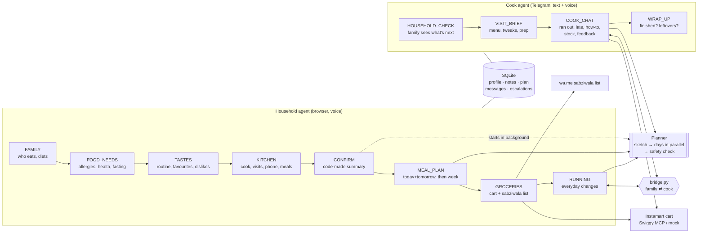

# Anyaa Kitchen Agent

A voice agent for the Indian household kitchen. It gets to know the family, plans the week's meals with
them, turns the plan into an Instamart cart and a sabziwala list, and then works with the cook every day
on Telegram so the plan actually gets cooked.

> **Submission:** demo video: _add link_ · write-up: **[WRITEUP.md](WRITEUP.md)** · deeper notes: [`docs/`](docs)

Two ideas shape every decision:

- **The household barely has to think.** Anyaa proposes and they say yes. Onboarding is five short parts,
  the week is one or two turns, groceries are one yes. After that, the family hears from Anyaa only when
  something needs them.
- **The cook is where the day's context comes from.** The cook sees what ran out, what was left over and
  who didn't eat the bhindi. Anyaa talks to the cook every visit, so the family doesn't have to be asked.

---

## Run it

Needs Docker, an Azure Speech key, a Claude login token, and (for the cook) a Telegram bot token.

```bash
cp .env.example .env                 # fill in the keys (see below)
./scripts/fetch-agent-sdk.sh         # once: downloads the Agent SDK wheel into vendor/ (113 MB)
APP_PORT=8010 docker compose up --build -d
```

Open **<http://localhost:8010/test-onboarding>**. This is the full demo page: the household chat (voice or
text), the flow stepper, live panels for the profile, plan and groceries, and the cook's Telegram chat
with a **⏩ Next step** button that moves the simulated clock to the next cook event.

| `.env` | What it's for |
|---|---|
| `CLAUDE_CODE_OAUTH_TOKEN` | The Claude Agent SDK runs on a Claude subscription login (`claude setup-token`) |
| `LLM_MODEL` | `haiku` by default (cheapest); `sonnet` works too |
| `AZURE_SPEECH_KEY`, `AZURE_SPEECH_REGION` | Speech: browser STT/TTS through short-lived tokens, and cook voice notes |
| `TELEGRAM_BOT_TOKEN` | The cook channel. The cook opens the bot and taps Start once to share their number |
| `INSTAMART_MODE` | `mock` (default) or `mcp` for real Swiggy Instamart (log in from `/instamart-lab.html`) |

Other pages: `/` is the plain household page, and `/instamart-lab.html` connects Swiggy and picks the
delivery address.

---

## The agents

Two agents, built on the **Claude Agent SDK**, share one SQLite database. Each agent is a chain of
**nodes**. A node is a prompt, **only its own tools**, a live context block, a one-line scope and an
opener. **Code decides which node is active, not the model.** A node ends only through its `*_done`
tool, and that tool's requirements are checked in code.



### How the two sides stay in sync (`app/bridge.py`)

```mermaid
sequenceDiagram
    participant F as Family (chat)
    participant A as Anyaa
    participant P as Planner + safety check
    participant C as Cook (Telegram)

    A->>F: Coming up: Raju's evening visit. Dinner is paneer curry + roti. Change anything?
    F->>A: ok
    A->>C: Brief: tonight's dinner, tweaks, prep for tomorrow (text + voice note)
    C->>A: paneer nahi hai
    A->>P: change ONLY tonight's dinner, makeable now (code picks the meal)
    P-->>A: chana masala + roti, safe for everyone
    A->>C: Make chana masala instead
    A->>F: Heads up: paneer ran out, so tonight's dinner is now chana masala + roti. Paneer is in your Instamart cart.
    F->>A: tomorrow no rajma
    A->>P: change the plan
    A-->>C: (only if already briefed for that meal) Small change from the family...
    A->>C: Wrap-up: anything finished? leftovers? did everyone eat?
    C->>A: atta running low
    A->>F: Raju says atta is running low; added to your Instamart cart, please order.
```

| One side does | The other side hears |
|---|---|
| Family changes a meal the cook was **already briefed** for | Cook gets the change on Telegram right away |
| Family changes a later meal | It's in the next brief |
| Cook: something ran out | Code picks the meal; only that meal is re-planned and safety-checked; family told; item added to the cart |
| Cook: something is low | Added to the Instamart cart (never replacing it); family asked to order |
| Cook can't settle it safely | Family gets an A/B question; their answer goes back to the cook with the new menu |

---

## Why each piece is there

| Piece | Why |
|---|---|
| **Claude Agent SDK** (`agent.py`, `tools/`) | Real tool loop, sessions per node, hooks for logging, structured output for one-shot calls. Runs on a subscription login during development (no API credits). `tools=[]` and `setting_sources=[]`, so only our tools exist. |
| **Nodes with their own tools** (`flow.py`) | In early tests, one big agent asked about the cook while still learning names, lost a curd intolerance, and recapped constantly. If a tool doesn't exist in a node, the model can't drift into that topic. |
| **Scope line on every message** | Resumed sessions keep their first system prompt. Live data and the "you are in X, only talk about Y" line ride on each message, so they never go stale. |
| **`park_for_later`** | People mention allergies while you're asking about the cook. The fact is saved as "parked", sorted into a proper note in the right node, and `confirm_profile` refuses while anything is parked. |
| **Free-form notes** (`member`, `category`, `detail`, `strict`, `quote`) | Real families don't fit a schema ("itchy with arbi but traces are fine", "no rice at dinner"). The user's exact words are kept, and the planner and the safety check read them directly. |
| **Code guards on facts** | `upsert_member` needs the user's own words for a diet and refuses a contradiction ("I eat chicken sometimes" can't become eggetarian). The CONFIRM summary is built from facts written by code, so it can't say "both veg". |
| **Planner in steps** (`planner.py`) | One big call took 219 s. Sketch → days in parallel, with thinking off, takes about 70 s, and it starts in the background the moment the profile is confirmed. Groceries are written only when they're needed. |
| **A separate safety check** | Planning juggles taste, nutrition, variety and the cook's time, so an allergy is easy to drop. A second, focused call checks every ingredient (oil, tempering, garnish) against every strict note and diet. Unsafe days are rewritten (twice at most), and an unsafe plan can't be agreed. Every cook-side change goes through it too. |
| **Time-aware planning** | At 1:30 pm the plan starts with dinner, not breakfast. Today and tomorrow are agreed first (what matters now), then the week around them. |
| **Two agents, not one** | Privacy by structure: the cook agent's context never contains health notes, so it can't leak "Papa's BP". Cook notes say what to do ("less salt for Papa ji"), never why. |
| **Telegram for the cook** (`telegram.py`, `cook.py`) | A real phone in the demo: text plus a voice note per brief, and voice replies transcribed by Azure. WhatsApp Cloud API needs paid, pre-approved templates to message first. |
| **Instamart via Swiggy MCP** (`swiggy.py`, `instamart.py`, `cart.py`) | A real cart. The MCP can place real cash-on-delivery orders, so only 5 tools are allowlisted (`search_products`, `get_addresses`, `your_go_to_items`, `get_cart`, `update_cart`) and it **never checks out**. A mock with the same interface is the default. |
| **Simulated clock** (`clock.py`) | Real time plus an offset, so "⏩ Next step" can show a whole day of cook visits in a few minutes. |
| **Reply cleaning** (`agent.py`) | Haiku sometimes echoes `<context>`, `[start]` or stage directions like "(waiting for their answer)". These are stripped in code, and the reply is the last real spoken line. |
| **Turn logs** (`obs.py`) | `logs/events.jsonl`: `turn_start → tool_call… → turn_end` with one `turn_id` and timings. Every bug fixed in this repo was found by reading these logs. |

## Key decisions

1. **Low effort for the household, lots of contact with the cook.** Proposals instead of questions, a yes
   instead of a form. Before each visit the family gets one "coming up, change anything?" message
   (the night before for early visits), and the cook is briefed after that.
2. **Safety lives in code and in a separate check, not in the conversation model.** Diet contradictions,
   parked facts, unsafe plans, which meal a swap may touch, the summary's facts: all are enforced in code.
3. **One meal, small tweaks.** One base dish per sitting with per-person changes ("take out Papa ji's
   portion before the salt"). A separate dish only when a diet needs it, from a shared base. Nutrition is
   planned in (protein every meal, greens, whole grains, treats as treats) but talked about through taste.
4. **The cook is a professional.** The brief has what to make, for whom, the tweaks, prep for next time
   and an invite to reply. Recipes only when the cook asks.
5. **Haiku by default.** The cheapest model. Code-side guardrails are what keep it safe; Sonnet works
   with `LLM_MODEL=sonnet`.
6. **English only for now.** Hindi was tested and works through Azure voices. It's switched off to keep
   the demo consistent (`SPEECH_LANGUAGE`, voices in `.env`).

## Real vs simulated

| | |
|---|---|
| LLM | **Real**: Claude Agent SDK, `haiku` by default |
| Speech | **Real**: Azure Speech (browser STT/TTS via tokens; OGG voice notes and STT for the cook) |
| Cook channel | **Real**: Telegram bot (text + voice notes, voice replies) |
| Instamart | **Real** Swiggy MCP when logged in (cart only, never orders), otherwise mock. POC assumption: the address is always serviceable; if Swiggy says it isn't right now, that cart step uses the mock (logged) |
| Sabziwala | `wa.me` link with the list (the user sends it) |
| Clock | **Simulated**: real time plus an offset, moved by "⏩ Next step" |
| Evals | Not built yet (see the write-up) |

## Code layout

```
app/
  api.py         HTTP routes; starts the Telegram poller
  agent.py       one turn on the Claude Agent SDK: context, session, reply cleaning, node chaining
  flow.py        the nodes: prompt files, tools, context, scope, hints
  tools/         each node's tools: onboarding.py, plan.py, home.py (groceries + everyday), cook.py
  bridge.py      family ⇄ cook: who hears what, which meal, recent messages for both agents
  cook.py        the cook's day on the clock: household check, brief, wrap-up; Telegram replies
  planner.py     sketch → day details (parallel) → safety check → fixes; changes; groceries
  cart.py        grocery lines → Instamart cart + sabziwala link; add-to-cart for cook reports
  llm.py         one-shot structured calls (Agent SDK structured output)
  prompts/       persona, onboarding rules, one prompt per node, planner, safety check, brief
  models.py      every data shape (Pydantic)
  queries.py     every database read and write;  db.py + schema.sql: SQLite
  profile.py     the household as text, and as code-made facts for the summary
  speech.py      Azure TTS/STT;  telegram.py: bot;  swiggy.py: OAuth + allowlisted MCP
  instamart.py   search + cart (mock and Swiggy);  clock.py, obs.py, voice.py
web/             test-onboarding.html (demo), index.html, instamart-lab.html, js/, css/
docs/            agents · onboarding · planning · cook · integrations · observability
```
