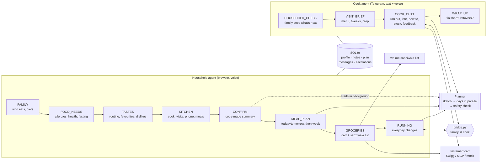
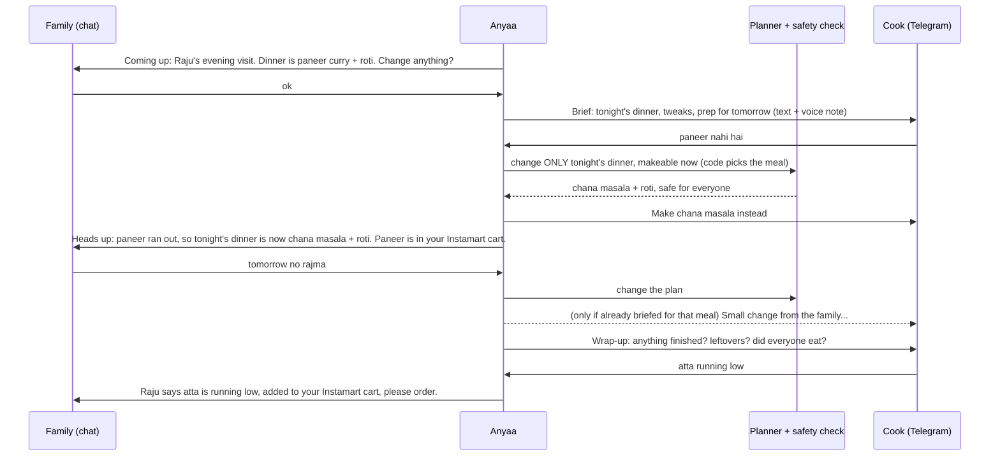

# Anyaa Kitchen Agent

A voice agent for the Indian household kitchen. It gets to know the family, plans the week's meals with
them, turns the plan into an Instamart cart and a sabziwala list, and then works with the cook every day
on Telegram so the plan actually gets cooked.

> demo video: **[Google Drive](https://drive.google.com/drive/folders/1HxCjsXXMq0BdRLDUDv1ypbt1-Q3MHdon?usp=sharing)** · write-up: **[WRITEUP.md](WRITEUP.md)** · deeper notes: [`docs/`](docs)

Two ideas shape every decision:

- **The household barely has to think.** Anyaa proposes and they say yes. Onboarding is five short parts,
  the week is one or two turns, groceries are one yes. After that, the family hears from Anyaa only when
  something needs them.
- **The cook is where the day's context comes from.** The cook sees what ran out, what was left over and
  who didn't eat the bhindi. Anyaa talks to the cook every visit, so the family doesn't have to be asked.

---

## Run it

Needs Docker, an Azure Speech key, a Claude login token, and (for the cook) a Telegram bot token.

```bash
cp .env.example .env                 # fill in the keys (see below)
./scripts/fetch-agent-sdk.sh         # once: downloads the Agent SDK wheel into vendor/ (113 MB)
APP_PORT=8010 docker compose up --build -d
```

Open **<http://localhost:8010/test-onboarding>**. This is the full demo page: the household chat (voice or
text), the flow stepper, live panels for the profile, plan and groceries, and the cook's Telegram chat
with a **⏩ Next step** button that moves the simulated clock to the next cook event.

| `.env` | What it's for |
|---|---|
| `CLAUDE_CODE_OAUTH_TOKEN` | The Claude Agent SDK runs on a Claude subscription login (`claude setup-token`) |
| `LLM_MODEL` | `haiku` by default (cheapest); `sonnet` works too |
| `AZURE_SPEECH_KEY`, `AZURE_SPEECH_REGION` | Speech: browser STT/TTS through short-lived tokens, and cook voice notes |
| `TELEGRAM_BOT_TOKEN` | The cook channel. The cook opens the bot and taps Start once to share their number |
| `INSTAMART_MODE` | `mock` (default) or `mcp` for real Swiggy Instamart (log in from `/instamart-lab.html`) |

Other pages: `/` is the plain household page, and `/instamart-lab.html` connects Swiggy and picks the
delivery address.

---

## The agents

Two agents, built on the **Claude Agent SDK**, share one SQLite database. Each agent is a chain of
**nodes**. A node is a prompt, **only its own tools**, a live context block, a one-line scope and an
opener. **Code decides which node is active, not the model.** A node ends only through its `*_done`
tool, and that tool's requirements are checked in code.



### How the two sides stay in sync (`app/bridge.py`)



| One side does | The other side hears |
|---|---|
| Family changes a meal the cook was **already briefed** for | Cook gets the change on Telegram right away |
| Family changes a later meal | It's in the next brief |
| Cook: something ran out | Code picks the meal; only that meal is re-planned and safety-checked; family told; item added to the cart |
| Cook: something is low | Added to the Instamart cart (never replacing it); family asked to order |
| Cook can't settle it safely | Family gets an A/B question; their answer goes back to the cook with the new menu |

---

## Key decisions

- **Code decides the risky parts, not the model.** Which node is active, which tools exist in it, when
  a node may end, whether a diet matches the user's own words, which single meal a cook-side swap may
  touch. Each of these started as a real failure in testing.
- **A separate safety check.** After planning, a second, focused LLM call checks every ingredient (oil,
  tempering, garnish included) against every strict note and diet. An unsafe plan can't be agreed, and
  every swap the cook triggers goes through it too.
- **Two agents, so privacy is structural.** The cook agent never sees health notes, so it can't leak them.
- **One meal, small tweaks.** One base dish per sitting, with per-person changes ("less salt for Papa ji").
- **Fast enough for voice.** The planner sketches, then plans days in parallel, and starts in the
  background as soon as the profile is confirmed. Haiku by default.

## Real vs simulated

| | |
|---|---|
| LLM, speech, cook channel | **Real**: Claude Agent SDK (Haiku), Azure Speech, Telegram bot |
| Instamart | **Real** Swiggy MCP cart (never orders) or a mock. If Swiggy says the address isn't serviceable right now, that step uses the mock |
| Sabziwala | `wa.me` WhatsApp link |
| Clock | Simulated, moved by "⏩ Next step" |
| Evals | Not built yet |

## Code layout

```
app/  agent.py (one turn) · flow.py (nodes) · tools/ (each node's tools) · bridge.py (family ⇄ cook)
      cook.py (cook's day) · planner.py · cart.py · prompts/ · models.py · queries.py
web/  test-onboarding.html (demo page)
docs/ agents · onboarding · planning · cook · integrations · observability
```
